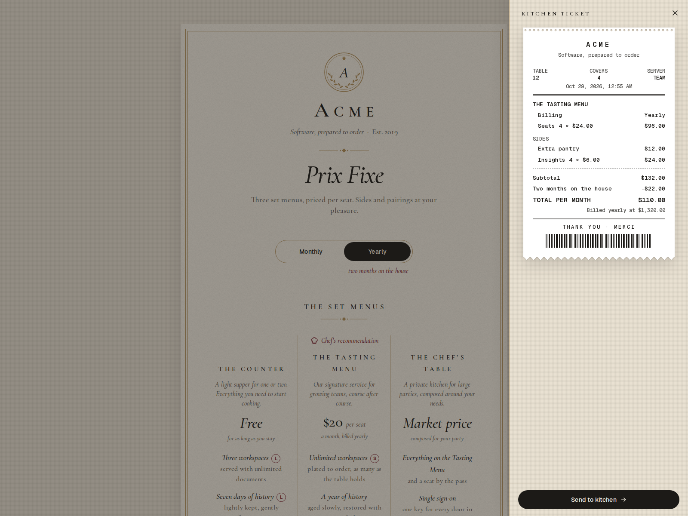
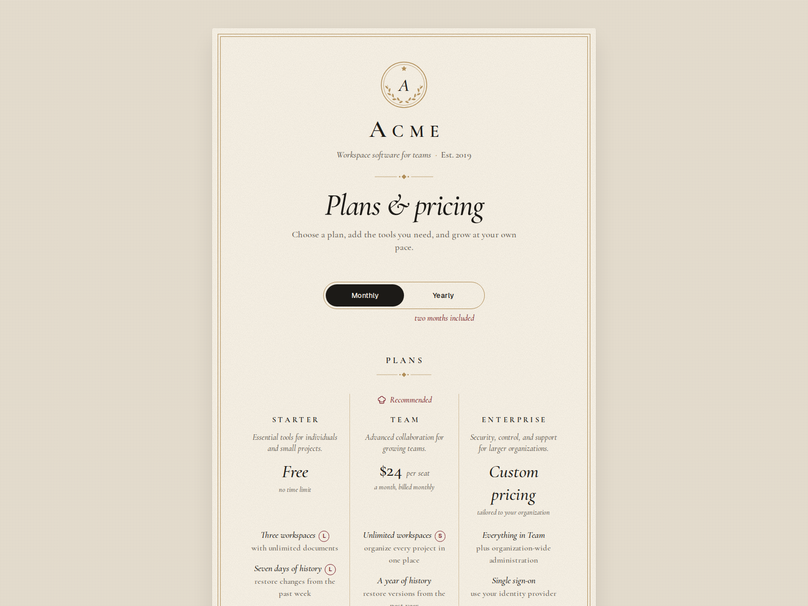

# Prix Fixe

A SaaS pricing page served as a fine-dining menu card on a linen tablecloth. Three set menus, sides with a seat stepper, a wine list of integrations, a note from the chef, and a thermal kitchen ticket that prints your order line by line.



Frontend only: checkout links to your service, with no payment backend or required environment variables. The social preview is generated by Next.js.

**Stack:** Next.js 16 (App Router), TypeScript (strict), Tailwind CSS v4, Motion, `next/font/google` (Cormorant Garamond, Geist, Geist Mono).

## Run it

```bash
npm install
npm run dev
```

## Customize in 2 minutes

1. Open `prixfixe.config.ts`. Set your house name, monogram, tagline, sales email,
   and checkout URL. Replace the fictional product descriptions and subscription policies.
2. Edit `menus` and `sides`: prices are monthly amounts in major currency units.
   Keep IDs stable because checkout links use them. Set your seat limits and annual discount.
3. Choose your copy: keep the restaurant version, or use the plain, serious example:

   ```bash
   # Save any customizations before replacing the active config.
   cp prixfixe.plain.config.ts prixfixe.config.ts
   ```

   Both files export the same typed config. The plain example uses USD / en-US,
   identical prices, and conventional plan, add-on, integration, and checkout labels.
4. Change the seven brand colors in `app/theme.css`, then preview desktop and mobile.
   If you change copy or annual discounts, also update the matching FAQ and billing labels.

| What | Where |
| --- | --- |
| Every word, price, link and list | `prixfixe.config.ts` |
| Screen colors (light and dark) | `app/theme.css` |
| Print palette / social-image palette | `app/print.css` / `app/opengraph-image.tsx` |
| Pricing math | `lib/order.ts` (`computeOrder`) |

The house, menus, sides, pairings, FAQ, small print and all interface labels live in `prixfixe.config.ts`. Screen components use the config and theme tokens, and Tailwind's default palette is switched off. Print and social-image palettes are defined separately to keep those outputs predictable.



### Prices

- `price` is the monthly price per seat in major units (`24` = $24). `0` renders "Free", `"market"` renders "Market price" and a "Book the table" button that opens `mailto:` your `salesEmail`.
- Annual charges use the monthly subtotal × (12 − `yearlyFreeMonths`), with free months clamped to 0–12. The displayed monthly equivalent is rounded to the currency’s minor unit; the annual charge is never calculated from that rounded display.
- Sides are either per seat (`per: "seat"`) or flat per month (`per: "table"`).
- Every amount is formatted with `Intl.NumberFormat` using `house.currency` and `house.locale`. Amounts are calculated in minor units (cents), so currencies without decimals work too.

### Euros and French formatting

Set these values in the active config:

```ts
currency: "EUR",
locale: "fr-FR",
```

Prices then read `24 €` on the menu and `24,00 €` on the ticket; a yearly charge
can read `1 320,00 €`. This changes formatting, not exchange rates or copy language.
Update the small-print currency wording to euros, and translate the copy if needed.
Tests cover both configs with USD/en-US and EUR/fr-FR, including the nonbreaking spaces.

### Checkout

"Send to kitchen" opens `house.checkoutUrl` with the order as query parameters:

```
https://acme.example/checkout?plan=tasting&billing=yearly&seats=5&addons=storage%2Canalytics
```

`addons` is a comma-separated list of side ids.

### Colors

`app/theme.css` holds the seven brand tokens (`--linen`, `--card`, `--ink`, `--muted`, `--rule`, `--accent`, `--ticket`) for light and dark. Dark mode follows the operating system. A few derived tokens are mixed from the brand tokens to keep text at WCAG AA contrast: `--muted-ink` for small secondary text, `--accent-ink` for accent text, `--ticket-ink` so the thermal print stays dark on light paper in both themes. If you change the brand tokens, check those contrasts again.

## Print and share

Use your browser's Print command. Select **A4**, portrait, 100% scale, and disable
browser headers and footers. The stylesheet sets 12 mm margins and a light paper
palette even when the screen uses dark mode. Both supplied configs fit on one page.
The printout includes plans, features, sides, the feature key, and pricing terms;
integrations, FAQ, controls, and the ticket overlay are omitted. The selected billing
cycle determines printed prices. Longer custom content may flow onto more pages.

`app/opengraph-image.tsx` generates a 1200 × 630 PNG of the menu and a half-printed
ticket. Next.js adds its Open Graph metadata automatically. On a self-hosted deployment,
set `SITE_URL` to your public origin (for example, `https://pricing.example.com`)
before building so social links use the correct host. Vercel supplies its production
host automatically; local development defaults to localhost. Names and prices come
from the active config; the sample order uses the recommended priced plan, default
seats/billing, and no sides. If there is no recommended priced plan, it uses the first
priced plan. The image has its own light palette; update it alongside `app/theme.css`.
Its bundled fonts require no runtime downloads and cover Latin copy, including French.
See [font notes and licenses](public/fonts/README.md) before adding other scripts.

## Verify

```bash
npm test                  # 96,000 order combinations plus boundary/format checks
npm run lint
npm run typecheck
npm run build
npx playwright install chromium
npm run test:e2e           # starts a local preview on port 3100
```

To use a server already running on another port:

```bash
PLAYWRIGHT_BASE_URL=http://localhost:3001 npm run test:e2e
```

Browser checks cover desktop/mobile tickets, light/dark A4 printing, both billing
cycles, printing with the ticket open, and the generated PNG and metadata. Run them
again after switching configs or currency/locale. PDF and image attachments are in
the Playwright test results. The browser's Google Fonts need network access at build
time; the social image fonts are local.

## Accessibility

- Semantic landmarks and headings; the billing toggle is a native radio group; sides are native checkboxes; the seat stepper is a native number input with labelled buttons.
- Visible focus rings everywhere, keyboard support throughout.
- The kitchen ticket is a modal dialog: focus moves into it, Tab is trapped, Esc closes it, the page behind is `inert`, and focus returns to the button that opened it.
- `prefers-reduced-motion`: prices still cross-fade but don't move, panels appear without sliding, and the ticket appears at once instead of printing.
- Both prices sit in the same grid cell, so switching billing never shifts the layout.

## Notes

- Cormorant Garamond as served by Google Fonts has no small-caps glyphs, so browsers draw the small caps from scaled capitals. Its default figures are oldstyle.
- Acme and the `.example` addresses are fictional placeholders.

## License

[MIT](LICENSE). Bundled fonts retain their separate SIL Open Font Licenses.
